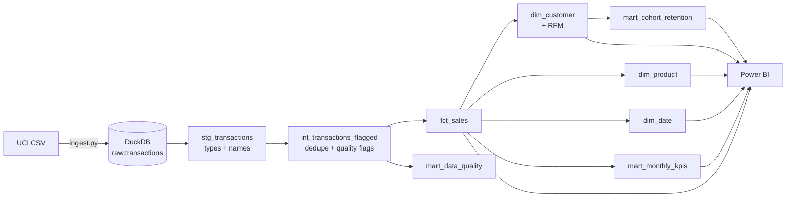
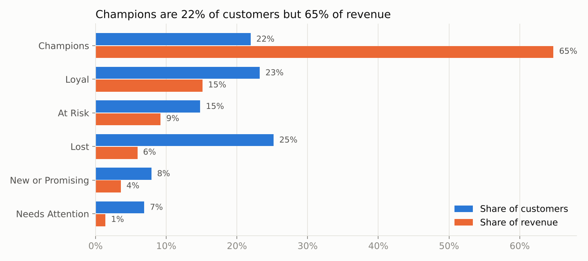
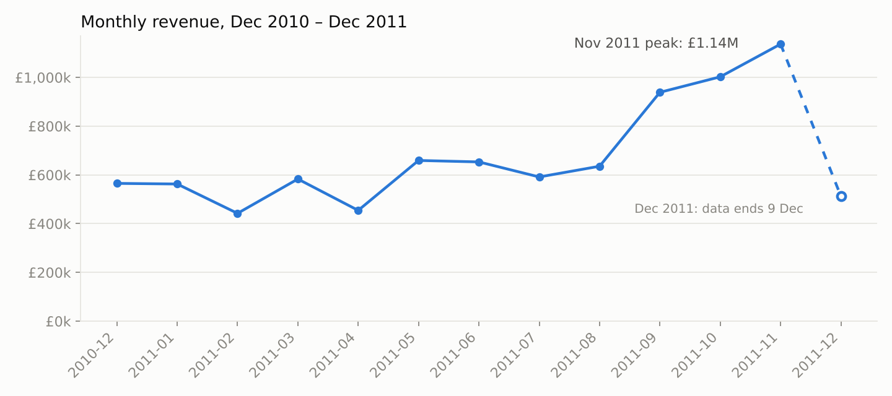
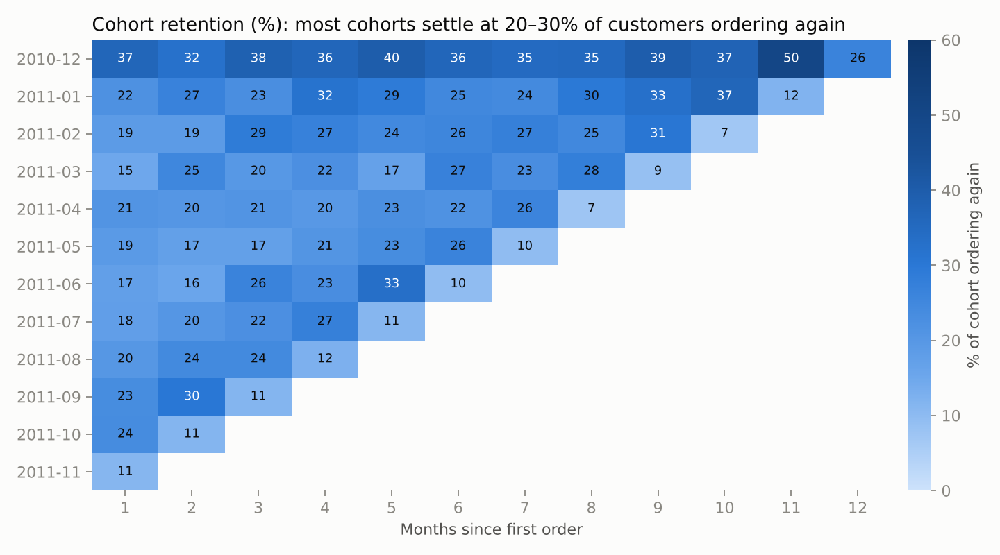

# Retail ELT Pipeline & Customer KPI Dashboard

**An end-to-end ELT pipeline that turns 541,909 messy retail transactions into a tested star schema and a customer KPI dashboard.**

The top 20% of customers drive **74.6%** of revenue, and 642 "At Risk" customers who used to buy often hold **£804K** of past revenue. They are the clearest target for a win-back campaign.

`Python` · `SQL` · `dbt` · `DuckDB` · `GitHub Actions` · `Power BI`

---

## The problem

The [UCI Online Retail dataset](https://archive.ics.uci.edu/dataset/352/online+retail) holds every transaction of a UK online gift retailer from Dec 2010 to Dec 2011. As exported, it can't be reported on reliably:

- 5,268 exact duplicate rows
- 133,846 lines with no customer ID
- 9,251 cancellation lines mixed in with sales
- 2,361 lines for postage, bank charges, fees and manual adjustments that aren't products
- dates and IDs stored as text

## The pipeline



- **Extract and load:** `ingest/ingest.py` downloads the source file and loads it untouched into DuckDB.
- **Transform:** dbt models it in three layers: staging (types and names), intermediate (deduplication and one documented quality flag per rule), and marts (a star schema plus KPI and retention tables).
- **Test:** 42 dbt data tests check keys are unique and not null, every fact row joins to its dimensions, values are non-negative, and categories are valid.
- **Automate:** a GitHub Actions workflow rebuilds and tests everything on every push.

## Data quality: what was removed and why

| Step | Rows |
| --- | ---: |
| Raw rows | 541,909 |
| Exact duplicates removed | 5,268 |
| Missing customer ID | 133,846 |
| Cancellations | 9,251 |
| Non-product lines (postage, fees, adjustments) | 2,361 |
| Zero price | 33 |
| **Valid sales lines kept** | **391,150** |

Lines without a customer ID are kept in the intermediate layer, so total sales can still be reported, but they're excluded from customer metrics.

## Findings

**£8.74M revenue · 18,402 orders · 4,334 customers · £474.80 average order value**

### Revenue is concentrated in a small group of customers



- The top 20% of customers produce **74.6%** of revenue, and the top 1% alone produce **32.0%**.
- **Champions** (recent, frequent, high-spend) are 22% of customers but 65% of revenue.
- **At Risk** customers (frequent buyers who've gone quiet) are 642 people with £804K of past revenue, the best win-back target.

### Sales build strongly into the Q4 gifting season



Revenue doubles from around £450K in Feb and Apr 2011 to **£1.14M in Nov 2011**. December 2011 looks low only because the data stops on 9 December.

### About one in five new customers comes back the next month



For customers acquired Jan–Sep 2011, an average of **19.3%** order again the following month. The Dec 2010 cohort retains better because it includes long-standing customers who bought before the data starts. The last cell in each row is a partial month.

## Recommendations

1. **Protect the top 20%.** With 74.6% of revenue at stake, give Champions a dedicated account contact and early access to the Q4 range.
2. **Run a win-back campaign for At Risk customers** in September, before the Q4 peak, and track it with this dashboard's segment view.
3. **Make the second order happen.** With 1-month retention near 19%, a time-limited second-order incentive is the cheapest growth lever.

## Run it yourself

```bash
pip install -r requirements.txt
python ingest/ingest.py                 # download + load raw data
dbt build --profiles-dir .              # 9 models + 42 tests
python analysis/export_and_charts.py    # CSVs for Power BI + README charts
dbt docs generate --profiles-dir . && dbt docs serve --profiles-dir .   # lineage graph
```

Build the Power BI dashboard from the exports by following [`powerbi/README.md`](powerbi/README.md).

## Project structure

```
ingest/ingest.py              extract + load into DuckDB
models/staging/               typed source model + source tests
models/intermediate/          dedupe + data quality flags
models/marts/                 fct_sales, dim_customer, dim_product, dim_date, KPI + retention marts
tests/generic/non_negative.sql  custom dbt test
analysis/export_and_charts.py   Power BI exports + charts
powerbi/                      dashboard build guide (+ .pbix)
.github/workflows/dbt.yml     CI: rebuild + test on every push
```

## Notes and limitations

- RFM scores use quintiles over this one year of data; a production version would score on a rolling window.
- The source is a public sample from 2010–2011. The pipeline itself is source-agnostic: point `ingest.py` at a new extract and rerun.

*Data: Chen, D. (2015). Online Retail [Dataset]. UCI Machine Learning Repository, CC BY 4.0. Copy used from the Databricks "Spark: The Definitive Guide" repository.*
